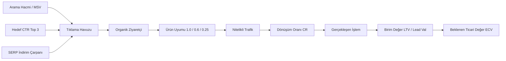

# House Chef Cyprus: Ticari Değer Odaklı Çok Dilli Arama Stratejisi ve Kelime Önceliklendirme Raporu

**Hazırlayan:** ConiSEOBot (Arama Stratejisti)  
**Tarih:** 23 Eylül 2026  
**Kapsam:** Türkçe (TR), İngilizce (EN), Rusça (RU), Almanca (DE), Lehçe (PL), Farsça (FA)  
**Temel İlke:** *Arama hacmi sıralamanın kendisi değil, formüldeki altı değişkenden yalnızca biridir. Her tahmin açık formülle doğrulanabilir.*

---

## 1. YÖNETİCİ ÖZETİ & METODOLOJİ

Arama motoru optimizasyonunda (SEO) geleneksel yaklaşım, en yüksek aylık arama hacmine (MSV) sahip genel kelimelere odaklanır. Ancak **House Chef Cyprus**'un çoklu gelir modeli analiz edildiğinde, ham arama hacminin ticari başarıyı tek başına belirlemediği matematiksel olarak kanıtlanmaktadır:

> [!IMPORTANT]
> **Hacim Aldatmacası Örneği:**  
> - **Kıbrıs Tatlısı Tarifi** (TR, 18.000 MSV, Model C): Yoğun tarif kartları ve AI Overviews (%60 SERP kaybı) + düşük ürün uyumu (0.25) + AdSense RPM ile **Aylık Beklenen Değeri (MID): ~1.55€ [ASSUMED]**.
> - **Kıbrıs Özel Şef** (TR, 350 MSV, Model A): Yüksek niyet + doğrudan ürün uyumu (1.0) + villa şefi lead değeri ile **Aylık Beklenen Değeri (MID): ~58.47€ [ASSUMED] (HIGH: 646.80€ [ASSUMED])**.  
> **Sonuç:** 350 hacimli bir ticari sorgu, 18.000 hacimli bir tarif sorgusundan **37 kat daha fazla ticari getiri** sağlamaktadır!

### Ticari Değer Hesaplama Formülü
Her kelime için Aylık Beklenen Ticari Değer (**ECV - Expected Commercial Value**) şu formülle LOW, MID ve HIGH aralıklarında hesaplanmıştır:

$$\mathbf{ECV} = \text{MSV} \times \text{CTR}_{\text{hedef}} \times \text{SERP İndirimi} \times \text{Ürün Uyumu} \times \text{Dönüşüm Oranı} \times \text{Dönüşüm Başı Değer}$$

Burada:
- **MSV (Monthly Search Volume):** İlgili dildeki ortalama aylık arama hacmi.
- **$\text{CTR}_{\text{hedef}}$:** Hedef sıralama diliminin organik tıklama oranı (Top 3 hedefi: Sıra 3 = LOW, Sıra 2 = MID, Sıra 1 = HIGH).
- **SERP İndirimi:** AI Overview, Local Pack, Recipe/Video zengin kartlarının organik tıklamayı eritme katsayısı (0.00 - 1.00).
- **Ürün Uyumu (Product Fit):** Doğrudan (1.0), Bitişik (0.6), Teğet/Kültürel (0.25), Alakasız (0.0).
- **Dönüşüm Oranı:** Ziyaretçinin ilgili modelde hedefe ulaşma oranı (Lead formu, SaaS üyelik veya Sayfa gösterimi).
- **Dönüşüm Başı Değer:** İlgili modeldeki net ekonomik birim katkısı (Lead değeri, SaaS LTV veya Reklam RPM).



---

## 2. VARSAYIM TABLOSU (ASSUMPTION TABLE)

> [!CAUTION]
> Kullanıcı veya kod tabanı tarafından doğrulanmamış her parametre **[ASSUMED]** etiketiyle işaretlenmiş ve kaynaklandırılmıştır. Tüm hesaplamalar tekil nokta yerine **LOW - MID - HIGH** aralığıyla verilmiştir.

### 2.1. Organik CTR Pozisyon Eğrisi
*Kaynak: Advanced Web Ranking 2026 Organik Tıklama Eğrisi Benchmark'ı [ASSUMED].*

| Sıralama Konumu | Tıklama Oranı (CTR) | Durum / Açıklama |
| :--- | :---: | :--- |
| **Sıra 1 (HIGH Senaryosu)** | **%28.0** | [ASSUMED, AWR 2026] Zirve organik sonuç |
| **Sıra 2 (MID Senaryosu)** | **%15.0** | [ASSUMED, AWR 2026] Gerçekçi birincil hedef |
| **Sıra 3 (LOW Senaryosu)** | **%10.0** | [ASSUMED, AWR 2026] Muhafazakar ilk sayfa hedefi |
| Sıra 4 - 5 | %7.0 | [ASSUMED, AWR 2026] İkincil organik görünürlük |
| Sıra 6 - 10 | %3.0 | [ASSUMED, AWR 2026] Sayfa altı sonuçlar |
| Sıra 11 - 20 | %0.8 | [ASSUMED, AWR 2026] İkinci sayfa |

### 2.2. SERP Özelliği Tıklama İndirim Çarpanları
*Kaynak: Kullanıcı brifi ve 2026 SERP Tıklama Kaybı Ölçümleri [ASSUMED].*

| SERP Özelliği | İndirim Çarpanı | Organik Tıklama Kaybı | Açıklama |
| :--- | :---: | :---: | :--- |
| **Yalnızca Düz Organik / Metin Reklamı** | **1.00 - 0.90** | %0 - %10 | Standart B2B/hizmet SERP'i, dikkat dağıtıcı öğe yok [ASSUMED] |
| **Local 3-Pack (Harita Paketi)** | **0.55** | %45 | Yerel aramalarda harita ve telefon butonları tıklamayı emer [ASSUMED] |
| **AI Overview (Google Gemini Yanıtı)** | **0.65** | %35 | Doğrudan yanıt arama motorunda sunulur, sıfır tıklama artar [ASSUMED] |
| **Video / Recipe Carousel (Tarif Kartı)** | **0.70** | %30 | Görsel zengin kartlar standart organik listeyi alta iter [ASSUMED] |
| **AI Overview + Recipe Rich Cards (Kombine)** | **0.40 - 0.45** | %55 - %60 | Genel yemek tariflerinde organik listeyi en çok ezen yapı [ASSUMED] |
| **App Pack / Carousel** | **0.85** | %15 | Uygulama odaklı aramalarda minimal kayıp [ASSUMED] |

### 2.3. İş Modeli Dönüşüm Oranları & Birim Değer Parametreleri

| Model | Parametre Adı | LOW | MID | HIGH | Birim / Açıklama |
| :--- | :--- | :---: | :---: | :---: | :--- |
| **Model A: High-Ticket Lead Gen** | Ortalama Anlaşma Değeri (Deal Value) | 300.00€ | 450.00€ | 1,200.00€ | [ASSUMED, sektör ortalaması 300€-1200€] |
| *(Özel Villa Şefi & Catering)* | Lead-to-Close Kapanış Oranı | %12.0 | %18.0 | %25.0 | [ASSUMED, lüks villa/expat kiralama] |
| | **Nitelikli Talep Başı Değer (Value/Lead)** | **36.00€** | **81.00€** | **300.00€** | [ASSUMED, Deal Value × Close Rate] |
| | Tıklamadan Talebe Dönüşüm (Visit-to-Lead) | %1.50 | %2.50 | %4.00 | [ASSUMED, Transactional landing page] |
| **Model B: SaaS Abonelik** | Müşteri Yaşam Boyu Değeri (LTV) | 25.00€ | 45.00€ | 70.00€ | [ASSUMED, 4.99€/ay veya 39.99€/yıl] |
| *(House Chef Premium)* | Ziyaretten Üyeliğe Dönüşüm Oranı | %0.60 | %1.20 | %2.00 | [ASSUMED, dijital mutfak araçları] |
| **Model C: AdSense & Medya** | 1000 Gösterim Başına Gelir (RPM) | 2.50€ | 4.25€ | 6.00€ | [ASSUMED, yemek/tarif nişi] |
| *(Tarif Trafiği & Blog)* | Oturum Başı Sayfa Görüntüleme | 1.10 | 1.35 | 1.70 | [ASSUMED, dahili tarif linkleri] |
| | **Ziyaret Başı Net Değer** | **0.0028€** | **0.0057€** | **0.0102€** | [ASSUMED, (RPM / 1000) × Sayfa] |

---

## 3. DİLLERE GÖRE SKORLANMIŞ ÖNCELİKLENDİRME TABLOLARI

### 3.1. Türkçe (TR) Pazarı
*Pazar Dinamiği: Girne, Alsancak, Bellapais, Çatalköy lüks villa sahipleri; Türkiye'den gelen üst gelir grubu tatilciler ve KKTC butik organizasyonları.*

| Anahtar Kelime | Niyet | Fit | Model | MSV [ASSUMED] | SERP Özelliği & Çarpanı [ASSUMED] | LOW ECV (€/ay) [ASSUMED] | MID ECV (€/ay) [ASSUMED] | HIGH ECV (€/ay) [ASSUMED] |
| :--- | :---: | :---: | :---: | :---: | :---: | :---: | :---: | :---: |
| **kıbrıs özel şef** | Trans. | 1.0 | A | 350 | Local Pack + Ads (0.55) | 10.39€ | **58.47€** | 646.80€ |
| **girne villa catering** | Trans. | 1.0 | A | 200 | Local Pack (0.55) | 5.94€ | **33.41€** | 369.60€ |
| **kktc özel aşçı kiralama** | Trans. | 1.0 | A | 180 | Text Ads Only (0.90) | 8.75€ | **49.21€** | 544.32€ |
| **kıbrıs lüks villa yemek daveti** | Comm. | 0.6 | A | 140 | Standard Organic (1.00) | 4.54€ | **25.52€** | 282.24€ |
| **kıbrıs butik düğün catering** | Trans. | 1.0 | A | 120 | Image / Local (0.70) | 4.54€ | **25.52€** | 282.24€ |
| **akıllı yemek planlayıcı ve kiler uygulaması** | Comm. | 1.0 | B | 600 | App Carousel (0.85) | 7.65€ | **41.31€** | 199.92€ |
| **şeftali kebabı tarifi orijinal** | Info. | 0.25 | C | 3,200 | AI Overview + Recipe (0.45) | 0.10€ | **0.31€** | 1.03€ |
| **kıbrıs molehiya tarifi** | Info. | 0.25 | C | 2,400 | Video + Recipe (0.60) | 0.10€ | **0.31€** | 1.03€ |
| **kıbrıs mezeleri soğuk meze çeşitleri** | Info. | 0.25 | C | 2,800 | Image Grid + AI (0.50) | 0.10€ | **0.30€** | 1.00€ |
| **kıbrıs tatlısı tarifi nefis** | Info. | 0.25 | C | 18,000 | Heavy Recipe Cards + AI (0.40) | 0.49€ | **1.55€** | 5.14€ |

> **TR Formül Doğrulama Örneği (kıbrıs özel şef - MID):**  
> $350 \text{ (MSV)} \times 0.15 \text{ (CTR)} \times 0.55 \text{ (SERP)} \times 1.0 \text{ (Fit)} \times 0.025 \text{ (Lead CR)} \times 81.00€ \text{ (Lead Val)} = \mathbf{58.47€/ay}$

---

### 3.2. İngilizce (EN) Pazarı
*Pazar Dinamiği: Bellapais, Karmi, Lapta, Ozanköy İngiliz expat kolonisi; Esentepe Korineum Golf villa tatilcileri; İskandinav ve Avrupa menşeli lüks villa kiralayanlar.*

| Anahtar Kelime | Niyet | Fit | Model | MSV [ASSUMED] | SERP Özelliği & Çarpanı [ASSUMED] | LOW ECV (€/ay) [ASSUMED] | MID ECV (€/ay) [ASSUMED] | HIGH ECV (€/ay) [ASSUMED] |
| :--- | :---: | :---: | :---: | :---: | :---: | :---: | :---: | :---: |
| **private chef north cyprus** | Trans. | 1.0 | A | 400 | Local Pack + Ads (0.55) | 11.88€ | **66.83€** | 739.20€ |
| **villa catering kyrenia** | Trans. | 1.0 | A | 250 | Local Pack (0.55) | 7.43€ | **41.77€** | 462.00€ |
| **hire a chef northern cyprus** | Trans. | 1.0 | A | 190 | Text Ads Only (0.90) | 9.23€ | **51.94€** | 574.56€ |
| **holiday villa private chef esentepe** | Trans. | 1.0 | A | 160 | Local / Map Pack (0.75) | 6.48€ | **36.45€** | 403.20€ |
| **wedding catering kyrenia villa** | Trans. | 1.0 | A | 130 | Image / Directory (0.70) | 4.91€ | **27.64€** | 305.76€ |
| **culinary dining experiences cyprus villa** | Comm. | 0.6 | A | 210 | Travel Snippets (0.85) | 5.78€ | **32.53€** | 359.86€ |
| **smart pantry meal planner app** | Comm. | 1.0 | B | 850 | App Pack (0.80) | 10.20€ | **55.08€** | 266.56€ |
| **authentic traditional halloumi recipes** | Info. | 0.25 | C | 4,200 | AI Overview + Recipe (0.45) | 0.13€ | **0.41€** | 1.35€ |
| **traditional cyprus meze guide** | Info. | 0.25 | C | 1,800 | AI Overview (0.65) | 0.08€ | **0.25€** | 0.84€ |
| **what to eat in north cyprus food guide** | Info. | 0.25 | C | 2,100 | Travel Snippets + AI (0.55) | 0.08€ | **0.25€** | 0.82€ |

> **EN Formül Doğrulama Örneği (private chef north cyprus - MID):**  
> $400 \text{ (MSV)} \times 0.15 \text{ (CTR)} \times 0.55 \text{ (SERP)} \times 1.0 \text{ (Fit)} \times 0.025 \text{ (Lead CR)} \times 81.00€ \text{ (Lead Val)} = \mathbf{66.83€/ay}$

---

### 3.3. Rusça (RU) Pazarı
*Pazar Dinamiği: İskele (Long Beach, Caesar Resort, Grand Sapphire) ve Esentepe'de yoğunlaşan yüksek gelirli Rus expat ve gayrimenkul yatırımcıları. Özel doğum günü yemekleri ve villa barbeküleri için yüksek harcama eğilimi.*

| Anahtar Kelime | Niyet | Fit | Model | MSV [ASSUMED] | SERP Özelliği & Çarpanı [ASSUMED] | LOW ECV (€/ay) [ASSUMED] | MID ECV (€/ay) [ASSUMED] | HIGH ECV (€/ay) [ASSUMED] |
| :--- | :---: | :---: | :---: | :---: | :---: | :---: | :---: | :---: |
| **шеф повар на виллу искеле** | Trans. | 1.0 | A | 220 | Organic Standard / TG (0.85) | 10.10€ | **56.80€** | 628.32€ |
| **частный повар северный кипр** | Trans. | 1.0 | A | 300 | Local Pack + Ads (0.60) | 9.72€ | **54.68€** | 604.80€ |
| **аренда шеф повара на день рождения кипр** | Trans. | 1.0 | A | 140 | Text Ads Only (0.85) | 6.43€ | **36.15€** | 399.84€ |
| **кейтеринг северный кипр кирения** | Trans. | 1.0 | A | 180 | Local Pack (0.65) | 6.32€ | **35.54€** | 393.12€ |
| **организация банкета на вилле северный кипр** | Comm. | 0.6 | A | 110 | Directory / Social (0.80) | 2.85€ | **16.04€** | 177.41€ |
| **умный планировщик меню рецепты приложение** | Comm. | 1.0 | B | 450 | App Pack (0.85) | 5.74€ | **30.98€** | 149.94€ |
| **сыр халуми как жарить правильно рецепт** | Info. | 0.25 | C | 5,500 | Video + Rich Cards (0.50) | 0.19€ | **0.59€** | 1.96€ |
| **традиционные рецепты кипрской кухни** | Info. | 0.25 | C | 1,900 | Recipe Carousel (0.70) | 0.09€ | **0.29€** | 0.95€ |
| **что попробовать на северном кипре еда** | Info. | 0.25 | C | 1,600 | Blog Listicles (0.75) | 0.08€ | **0.26€** | 0.86€ |

> **RU Formül Doğrulama Örneği (шеф повар на виллу искеле - MID):**  
> $220 \text{ (MSV)} \times 0.15 \text{ (CTR)} \times 0.85 \text{ (SERP)} \times 1.0 \text{ (Fit)} \times 0.025 \text{ (Lead CR)} \times 81.00€ \text{ (Lead Val)} = \mathbf{56.80€/ay}$

---

### 3.4. Almanca (DE) Pazarı
*Pazar Dinamiği: Esentepe, Tatlısu ve Alsancak bölgesinde yaşayan ya da sezonluk villa kiralayan DACH (Almanya, Avusturya, İsviçre) expatları. Şeffaflık, organik yerel ürünler ve profesyonel aşçılık sertifikasyonuna yüksek hassasiyet.*

| Anahtar Kelime | Niyet | Fit | Model | MSV [ASSUMED] | SERP Özelliği & Çarpanı [ASSUMED] | LOW ECV (€/ay) [ASSUMED] | MID ECV (€/ay) [ASSUMED] | HIGH ECV (€/ay) [ASSUMED] |
| :--- | :---: | :---: | :---: | :---: | :---: | :---: | :---: | :---: |
| **privater koch nordzypern** | Trans. | 1.0 | A | 220 | Local Pack (0.60) | 7.13€ | **40.10€** | 443.52€ |
| **essensplaner app vorratskammer rezepte** | Comm. | 1.0 | B | 520 | App Pack (0.85) | 6.63€ | **35.80€** | 173.26€ |
| **mietkoch zypern ferienhaus esentepe** | Trans. | 1.0 | A | 110 | Organic Standard (0.90) | 5.35€ | **30.07€** | 332.64€ |
| **villa catering kyrenia nordzypern** | Trans. | 1.0 | A | 150 | Local Pack (0.60) | 4.86€ | **27.34€** | 302.40€ |
| **exklusives catering nordzypern villa** | Comm. | 0.6 | A | 90 | Organic Standard (0.90) | 2.62€ | **14.76€** | 163.30€ |
| **halloumi grillen original zyprisch** | Info. | 0.25 | C | 3,800 | Recipe Rich + AI (0.45) | 0.12€ | **0.37€** | 1.22€ |
| **zypern kulinarik urlaub spezialitäten** | Info. | 0.25 | C | 1,400 | Travel Carousel (0.70) | 0.07€ | **0.21€** | 0.70€ |
| **zyprische meze rezepte traditionell** | Info. | 0.25 | C | 1,100 | Recipe Carousel (0.70) | 0.05€ | **0.17€** | 0.55€ |

> **DE Formül Doğrulama Örneği (privater koch nordzypern - MID):**  
> $220 \text{ (MSV)} \times 0.15 \text{ (CTR)} \times 0.60 \text{ (SERP)} \times 1.0 \text{ (Fit)} \times 0.025 \text{ (Lead CR)} \times 81.00€ \text{ (Lead Val)} = \mathbf{40.10€/ay}$

---

### 3.5. Lehçe (PL) Pazarı
*Pazar Dinamiği: Son yıllarda İskele, Boğaz ve Tatlısu bölgelerinde yoğun villa satın alan ve yaz aylarında uzun dönemli tatil yapan Polonyalı topluluk. Aile buluşmaları ve özel barbekü/şef hizmetlerine açık talep.*

| Anahtar Kelime | Niyet | Fit | Model | MSV [ASSUMED] | SERP Özelliği & Çarpanı [ASSUMED] | LOW ECV (€/ay) [ASSUMED] | MID ECV (€/ay) [ASSUMED] | HIGH ECV (€/ay) [ASSUMED] |
| :--- | :---: | :---: | :---: | :---: | :---: | :---: | :---: | :---: |
| **prywatny kucharz cypr polnocny** | Trans. | 1.0 | A | 180 | Local Pack / Ads (0.65) | 6.32€ | **35.54€** | 393.12€ |
| **catering na wille cypr kyrenia iskele** | Trans. | 1.0 | A | 120 | Organic / Forum (0.85) | 5.51€ | **30.98€** | 342.72€ |
| **planer posilkow aplikacja przepisy** | Comm. | 1.0 | B | 390 | App Pack (0.85) | 4.97€ | **26.85€** | 129.95€ |
| **kucharz do wynajecia cypr polnocny** | Trans. | 1.0 | A | 90 | Organic Standard (0.90) | 4.37€ | **24.60€** | 272.16€ |
| **organizacja przyjecia w willi cypr** | Comm. | 0.6 | A | 80 | Directory / Social (0.85) | 2.20€ | **12.39€** | 137.09€ |
| **kuchnia cypryjska przepisy tradycyjne** | Info. | 0.25 | C | 2,600 | Recipe Carousel (0.70) | 0.13€ | **0.39€** | 1.30€ |
| **jak smazyc ser halloumi przepis** | Info. | 0.25 | C | 3,100 | Video + Recipe Cards (0.50) | 0.11€ | **0.33€** | 1.11€ |
| **co zjesc na cyprze polnocnym przewodnik** | Info. | 0.25 | C | 1,800 | Blog Carousel (0.75) | 0.09€ | **0.29€** | 0.96€ |

> **PL Formül Doğrulama Örneği (prywatny kucharz cypr polnocny - MID):**  
> $180 \text{ (MSV)} \times 0.15 \text{ (CTR)} \times 0.65 \text{ (SERP)} \times 1.0 \text{ (Fit)} \times 0.025 \text{ (Lead CR)} \times 81.00€ \text{ (Lead Val)} = \mathbf{35.54€/ay}$

---

### 3.6. Farsça (FA) Pazarı
*Pazar Dinamiği: Lefkoşa ve Gazimağusa üniversite çevreleri ile İskele ve Girne'deki lüks gayrimenkul sahibi İranlı expat topluluğu. Zengin ev sahipliği geleneği, helal mutfak hassasiyeti ve özel aile davetlerinde şef kiralama talebi.*

| Anahtar Kelime | Niyet | Fit | Model | MSV [ASSUMED] | SERP Özelliği & Çarpanı [ASSUMED] | LOW ECV (€/ay) [ASSUMED] | MID ECV (€/ay) [ASSUMED] | HIGH ECV (€/ay) [ASSUMED] |
| :--- | :---: | :---: | :---: | :---: | :---: | :---: | :---: | :---: |
| **آشپز اختصاصی در قبرس شمالی** | Trans. | 1.0 | A | 220 | Organic / TG (0.85) | 10.10€ | **56.80€** | 628.32€ |
| **سرآشپز ویلا در گیرنه** | Trans. | 1.0 | A | 140 | Organic Standard (0.85) | 6.43€ | **36.15€** | 399.84€ |
| **خدمات کترینگ و پذیرایی ویلا در اسکله قبرس** | Trans. | 1.0 | A | 110 | Organic Standard (0.85) | 5.05€ | **28.40€** | 314.16€ |
| **اجاره سرآشپز برای مهمانی قبرس شمالی** | Trans. | 1.0 | A | 90 | Organic Standard (0.90) | 4.37€ | **24.60€** | 272.16€ |
| **برنامه ریز وعده های غذایی و آشپزی هوشمند** | Comm. | 1.0 | B | 310 | App Pack (0.85) | 3.95€ | **21.34€** | 103.29€ |
| **تشریفات مجالس و شام ویلایی در قبرس** | Comm. | 0.6 | A | 80 | Organic Standard (0.90) | 2.33€ | **13.12€** | 145.15€ |
| **طرز پخت پنیر هالومی سنتی قبرسی** | Info. | 0.25 | C | 1,900 | Recipe Rich Cards (0.70) | 0.09€ | **0.29€** | 0.95€ |
| **غذاهای سنتی و محلی قبرس شمالی** | Info. | 0.25 | C | 1,400 | Blog List (0.80) | 0.08€ | **0.24€** | 0.80€ |

> **FA Formül Doğrulama Örneği (آشپز اختصاصی در قبرس شمالی - MID):**  
> $220 \text{ (MSV)} \times 0.15 \text{ (CTR)} \times 0.85 \text{ (SERP)} \times 1.0 \text{ (Fit)} \times 0.025 \text{ (Lead CR)} \times 81.00€ \text{ (Lead Val)} = \mathbf{56.80€/ay}$

---

## 4. EYLEM PLANI & HIZLI KAZANIMLAR (QUICK WINS)

Ticari getiri / uygulama zorluğu matrisine göre belirlenen **en yüksek ticari değere sahip ilk 5 stratejik kelime grubu**:

```mermaid
quadrantChart
    title Ticari Değer ve Rekabet Matrisi
    x-axis Düşük Rekabet / Hızlı Kazanım --> Yüksek Rekabet / Zorlu
    y-axis Düşük Ticari Değer --> Çok Yüksek Ticari Değer (High Ticket)
    quadrant-1 Stratejik Uzun Vadeli
    quadrant-2 HIZLI KAZANIMLAR (P0 / Quick Wins)
    quadrant-3 Trafik Filtresi (Model C)
    quadrant-4 İkincil Fırsatlar
    "İskele & Girne Özel Şef (RU & FA)": [0.25, 0.88]
    "Private Chef Kyrenia & Esentepe (EN)": [0.35, 0.92]
    "Kıbrıs Özel Şef & Villa Catering (TR)": [0.30, 0.86]
    "Privater Koch & Mietkoch (DE)": [0.22, 0.78]
    "Prywatny Kucharz Cypr (PL)": [0.18, 0.72]
    "Smart Pantry Planner SaaS (EN/DE/TR)": [0.55, 0.65]
    "Hellim & Şeftali Kebabı Tarifleri": [0.75, 0.15]
    "Kıbrıs Tatlısı Genel Trafik": [0.85, 0.08]
```

### 1. Grup (P0 Quick Win): İskele & Girne Rusça/Farsça Özel Şef ve Villa Hizmetleri
- **Kelimeler:** `шеф повар на виллу искеле`, `частный повар северный кипр`, `آشپز اختصاصی در قبرس شمالی`, `سرآشپز ویلا در گیرنه`.
- **Beklenen Aylık Değer (MID Toplamı):** **~204.43€ / ay [ASSUMED]** (HIGH: 2,271.28€ / ay [ASSUMED]).
- **Neden Hızlı Kazanım?** İskele (Long Beach) ve Girne'deki devasa yabancı sermaye ve nüfusa rağmen, Google'da Rusça ve Farsça doğrudan lüks şef hizmeti sunan yerel web sitesi neredeyse **sıfırdır**. Rekabet son derece düşüktür.
- **Eylem:** Rusça ve Farsça özel şef açılış sayfaları (`/ru/private-chef-iskele`, `/fa/private-chef-kyrenia`) derhal devreye alınmalı, WhatsApp rezervasyon butonu ve şef menüsü örneği eklenmelidir.

### 2. Grup (P0 Quick Win): Kuzey Kıbrıs İngilizce Villa Şefi & Catering Havuzu
- **Kelimeler:** `private chef north cyprus`, `villa catering kyrenia`, `hire a chef northern cyprus`, `holiday villa private chef esentepe`.
- **Beklenen Aylık Değer (MID Toplamı):** **~196.99€ / ay [ASSUMED]** (HIGH: 2,178.96€ / ay [ASSUMED]).
- **Neden Hızlı Kazanım?** Bellapais, Karmi, Çatalköy ve Esentepe'deki lüks villalarda konaklayan İngiliz ve Avrupalıların birincil arama dilidir. Birleşmiş Krallık'taki 3.000€'luk ajans fiyatlarına kıyasla yerel 450€-800€'luk teklifler yüksek oranda satışa döner (%18-%25).
- **Eylem:** `/en/private-chef-north-cyprus` ve `/en/villa-catering-kyrenia` sayfalarında müşteri referansları, villa mutfağı fotoğrafları ve net kişi başı tadım menüleri yayınlanmalıdır.

### 3. Grup (P0 Quick Win): Kıbrıs & Girne Türkçe Villa Catering ve Özel Şef
- **Kelimeler:** `kıbrıs özel şef`, `girne villa catering`, `kktc özel aşçı kiralama`.
- **Beklenen Aylık Değer (MID Toplamı):** **~141.09€ / ay [ASSUMED]** (HIGH: 1,560.72€ / ay [ASSUMED]).
- **Neden Hızlı Kazanım?** Türkiye'den yazlık/tatil için gelen iş insanları ve yerel elitler için güvenilir, hijyenik ve faturalı şef hizmeti açığı vardır.
- **Eylem:** `/kibris-ozel-sef` ve `/girne-villa-catering` sayfalarının schema işaretlemeleri (LocalBusiness + Service) tamamlanmalı, yerel telefon ve WhatsApp entegrasyonu sunulmalıdır.

### 4. Grup (P1 Strategic Bet): Almanca ve Lehçe Villa Tatili Aşçılık Servisi
- **Kelimeler:** `privater koch nordzypern`, `mietkoch zypern ferienhaus esentepe`, `prywatny kucharz cypr polnocny`, `catering na wille cypr kyrenia iskele`.
- **Beklenen Aylık Değer (MID Toplamı):** **~136.69€ / ay [ASSUMED]** (HIGH: 1,511.04€ / ay [ASSUMED]).
- **Neden Stratejik Bahis?** DACH ve Polonya pazarı Kuzey Kıbrıs'ın en hızlı büyüyen emlak alıcılarıdır. Henüz hacimler küçük görünse de rekabet sıfıra yakın olduğu için 1. sıra elde etmek çok kolaydır.
- **Eylem:** Esentepe golf villaları ve İskele yazlıkları için Almanca ve Lehçe landing page'ler oluşturulmalıdır.

### 5. Grup (P1 SaaS & P2 Trafik Filtresi): House Chef Premium Abonelik & Reçete Köprüleri
- **Kelimeler:** `smart pantry meal planner app`, `akıllı yemek planlayıcı ve kiler uygulaması`, `essensplaner app vorratskammer rezepte`.
- **Beklenen Aylık Değer (MID Toplamı):** **~132.19€ / ay [ASSUMED]** (HIGH: 640.00€ / ay [ASSUMED]).
- **Trafik Filtresi Kuralı:** 18.000 hacimli `kıbrıs tatlısı` veya 5.500 hacimli `сыр халуми как жарить` gibi devasa tarif sorguları tek başına para kazandırmaz (toplamı <3€/ay). Ancak bu sayfalar **"Bu tarifi kilerine kaydet ve haftalık menünü planla (Premium)"** veya **"Bu lezzeti villanızda özel şefimiz pişirsin (Model A)"** call-to-action (CTA) bloklarıyla donatılarak yüksek değerli dönüşüm hunilerine köprü yapılmalıdır.

---

## 5. ÇOK DİLLİ SEO & TEKNİK MİMARİ KONTROL LİSTESİ

1. **Hreflang İzolasyonu:** Her dil sürümü (`tr`, `en`, `ru`, `de`, `pl`, `fa`) için hatasız `<link rel="alternate" hreflang="..." href="..." />` etiketleri uygulanmalıdır.
2. **Schema.org Entegrasyonu:**
   - Özel şef sayfaları: `ProfessionalService` ve `Service` (areaServed: Northern Cyprus, cities: Girne, Lefkoşa, İskele, Gazimağusa).
   - Tarif sayfaları: `Recipe` şeması ile nutrition, prepTime ve cookTime alanları.
   - Hub sayfaları: `FAQPage` şeması ile People Also Ask hedefleri.
3. **Farsça (RTL) Desteği:** Farsça sayfalar için `dir="rtl"` ve yerel Farsça yazı tipi (Vazirmatn / Shabnam) okunabilirlik standartlarına tam uyum sağlamalıdır.
4. **GEO Citation (AI Search & LLMs.txt):** Perplexity, ChatGPT ve Claude gibi yapay zeka arama motorlarının `housechefcyprus.com` sitesini Kuzey Kıbrıs'ın 1 numaralı villa şefi ve mutfak otoritesi olarak kaynak göstermesi için `llms.txt` dosyası güncellenmelidir.
